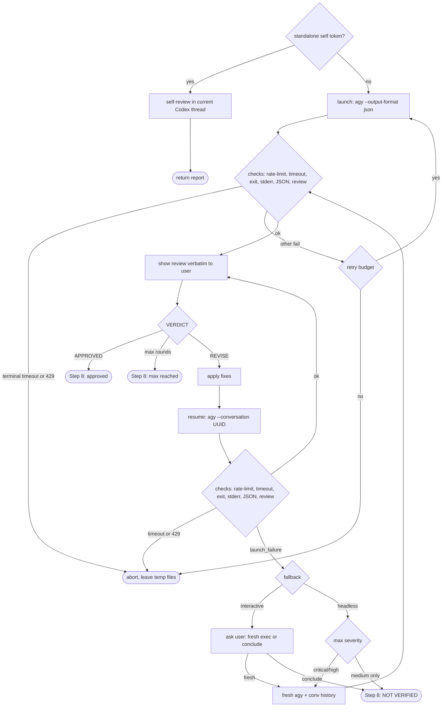

# Design Notes — adversarial-review

This document records the *why* behind the current implementation of the
`adversarial-review` skill: the empirical facts about external tools it
depends on, the rationale for each non-obvious design decision, and the
alternatives that were considered and rejected. Read `SKILL.md` for *what* the
skill does step by step; read this file when you need to understand *why it
does it that way* before changing something.

This document describes the current design only — git commit history serves as
the project changelog.

---

## §0. Purpose and audience

### Why this file exists

The skill orchestrates two AI systems (OpenAI Codex as the lead/master,
Antigravity CLI (`agy`) as the external reviewer) through a CLI subprocess
interface. Its behavior depends on details of `agy` (stream handling, exit
codes, flag support, persisted transcripts), details of the Codex harness (tool
output truncation, model interpretation of instructions), and trade-offs between
token cost, robustness, and operator ergonomics.

This file names the empirical facts, design decisions, invariants, and rejected
alternatives so contributors can change the skill confidently without breaking
load-bearing guards.

### Audiences

1. **A future Codex agent** resuming work on the skill in a fresh session.
2. **A human developer** who knows git and bash but not the Codex harness or
   Antigravity CLI quirks.
3. **A contributor** extending the skill who needs to know which invariants to
   preserve.

### What this file is NOT

- Not a user guide — that is `README.md`.
- Not a changelog — git history holds prior revisions and incident timelines.
- Not authoritative on current runtime steps — `SKILL.md` (and
  `references/runner.md` / `references/self-review.md`) is. If this file
  disagrees with `SKILL.md`, `SKILL.md` wins; update this file.

### How to use this file

Before modifying the skill:

1. Skim `§1. System context` to recall the flow.
2. Find the step you want to change in `§4. Design decisions`.
3. Check `§2. Antigravity CLI empirical facts` for CLI assumptions you rely on;
   re-run `§7` if `agy` has been upgraded.
4. Run `§7. Smoke test protocol` before and after your change.

---

## §1. System context

### One paragraph

`adversarial-review` is a Codex skill with two backends. With the standalone
`self` argument, Codex takes a terminal branch before any external setup and
performs a read-only adversarial review in the current thread. Otherwise Codex
(the "lead/master") writes an adversarial review prompt body to a temp file and
dispatches a runner subagent (`references/runner.md`). The runner prepends an
attempt-scoped session marker, invokes `agy --print` with that prompt as one
argument, and extracts `.response` from the JSON result. Codex then shows the
external review to the user verbatim, applies fixes to the plan or code, and
re-submits the revised state through `agy --conversation <UUID>`. The external
loop runs up to five rounds, or until the reviewer emits `VERDICT: APPROVED`.

### Roles

- **Lead (Codex).** Orchestrator. Reads `SKILL.md`, prepares prompts, displays
  reviews verbatim, authors fixes, and decides when to stop.
- **Self reviewer (Codex, opt-in).** The current thread applies the adversarial
  rubric directly. It does not delegate, invoke `agy`, or apply fixes.
- **Runner subagent.** Executes `agy`, validates prompt contracts and
  transcripts via `scripts/runner_contract.py`, handles the single bounded
  non-timeout/non-429 retry, and returns a compact result JSON path.
- **Reviewer (Antigravity, `gemini-4-argon-high`, effort high).** External AI
  process invoked per round in `agy` plan mode (`§9.7`).
- **User.** Reads the verbatim review Codex shows each round and
  accepts/rejects the final result.

### Flow



The diagram collapses retries and round counting; for exact ordering see
`SKILL.md` Steps 4 and 7 and `references/runner.md` Step R4.

### Why an external reviewer at all

An adversarial review from the *same* model as the writer tends toward
validation bias. Running the review through a different model family
(Antigravity CLI with `gemini-4-argon-high`, effort high) reduces shared blind
spots. The cost is an external dependency and a CLI-level integration — which
is what most of this document manages. Self mode is an explicit convenience
trade-off: it preserves the rubric and review discipline when external execution
is undesired or unavailable, without claiming independent-model diversity.

---

## §2. Antigravity CLI empirical facts

Empirical facts about `agy` relied on by the current skill. Re-run `§7` after
upgrading `agy`.

### §2.1. Invocation shapes

Headless mode requires the prompt as an argument to `-p` / `--print`:

```bash
agy -p "PROMPT" [OPTIONS]
agy -p "PROMPT" --conversation UUID [OPTIONS]  # explicit resume
agy -p "PROMPT" --continue [OPTIONS]           # newest conversation
```

Positional `-` is not a stdin sentinel: piping a prompt with `-` can exit 0
while ignoring the file and returning a generic greeting.

The skill keeps the prompt in a file for marker binding and diagnostics, then
passes it as one argument:

```bash
agy --print "$(cat /tmp/agy-prompt-*.md)" ...
```

Quoted command substitution produces one argv element and is not re-evaluated as
shell syntax. It strips trailing newlines only, which does not affect the
prompt contract. Extremely large prompts remain bounded by the platform's
argv-size limit.

### §2.2. Output streams

With `--output-format json`, stdout is one JSON object, not an event stream:

```json
{
  "conversation_id": "<uuid>",
  "status": "SUCCESS",
  "response": "<final reviewer text>",
  "duration_seconds": 3.7,
  "num_turns": 1,
  "usage": {}
}
```

Stderr is empty on a clean run and carries CLI diagnostics on failure. The
runner stores stdout in `/tmp/agy-stdout-${REVIEW_ID}.jsonl` (the `.jsonl`
suffix is kept for cleanup/archive path consistency even though it holds one
JSON object) and extracts `.response` into `/tmp/agy-review-${REVIEW_ID}.md`.

Two sticky-`ERROR` CLI behaviors require narrow transcript guards:

- **Interrupted model stream:** `agy` can exit `1` with empty stderr and a
  parseable JSON envelope (`status=ERROR`, empty `response`, generic
  `error="Agent execution terminated due to error."`, valid `conversation_id`),
  while the transcript records `The stream was interrupted`. Resuming that
  UUID can finish the review, yet JSON `status` and `error` remain sticky at
  `ERROR` even on a clean subsequent turn. `§4.15` defines the marker-bound
  recovery and acceptance guard for this case.
- **Recovered read-only missing-file error:** `agy` can exit `0` with a
  complete non-empty review response and valid UUID while retaining
  `status=ERROR` and `invalid_args`/`no such file or directory` after the
  reviewer guesses an auxiliary path (e.g. a nested manifest) and then
  recovers with a successful read of the same filename. `§4.16` and
  `scripts/runner_contract.py` define the deterministic guard for this case.

### §2.3. Session persistence

`agy` persists each conversation transcript at:

```
~/.gemini/antigravity-cli/brain/<UUID>/.system_generated/logs/transcript_full.jsonl
```

The directory name is the conversation ID accepted by `--conversation`. The
transcript contains the prompt, including the attempt-scoped
`ADVERSARIAL-REVIEW-SESSION` marker, enabling the positive content-bound
filesystem fallback:

```bash
find ~/.gemini/antigravity-cli/brain -name 'transcript_full.jsonl' \
  -newer /tmp/agy-prompt-${REVIEW_ID}.md \
  -exec grep -l "ADVERSARIAL-REVIEW-SESSION: ${REVIEW_ID}-${ATTEMPT_ID}" {} +
```

Exactly one match is required. The UUID is the path component immediately below
`brain/`; zero or multiple matches fail closed (`§4.1`).

### §2.4. Resume semantics

Use `--conversation UUID` to resume a specific reviewer conversation. Never use
`--continue` (or combine `--continue` with `--conversation`), because
`--continue` implicitly selects the newest conversation in the workspace rather
than the ID captured for this review.

**§2.4.1. `--continue` is implicit selection.** It selects a recent
conversation rather than binding to the review's captured UUID, creating a
wrong-session hazard against parallel `agy` work.

**§2.4.2. Process cwd does not fully bind native tool cwd.** `agy` has no
`-C` / `--cd` flag, and native `run_command` tool calls can start in
`~/.gemini/antigravity-cli/scratch` even after `cd "${REPO_ROOT}"`. The runner
combines `cd "${REPO_ROOT}" &&`, `--add-dir "${REPO_ROOT}"`, explicit
absolute repository context in every prompt, `git -C "${REPO_ROOT}"` for
diff commands, and absolute paths for file reads/searches.

**§2.4.3. Bad UUID silently creates a conversation.** Passing a nonexistent ID
via `--conversation` writes `warning: conversation "..." not found` to stderr,
exits `0`, and returns `SUCCESS` with a new `conversation_id`. The runner
rejects that warning and requires every resume result ID (primary or transcript
fallback) to equal the requested ID, regardless of verdict.

**§2.4.4. Conversation ID remains stable across resume.** Initial and resumed
calls return the same `conversation_id`. The runner refreshes the value from
every successful `REVISE` response so a future rotation cannot silently drift;
if a resume succeeds with zero ID matches, main retains the prior ID and
surfaces a diagnostic warning.

### §2.5. Known failure modes

| Trigger | Exit | stdout | stderr | Review extraction |
|---|---:|---|---|---|
| Success | 0 | one JSON object | empty | `.response` contains verdict |
| Prompt piped with positional `-` | 0 | success JSON with generic greeting | empty | no verdict; rejected |
| External timeout (`timeout 2400`) | 124 | partial or empty | partial or empty | rejected; terminal `timeout` |
| Internal CLI print timeout | may be 0 | `TIMEOUT`/`TIMED_OUT` or partial JSON with timeout error | may have `[agy] print timeout after` / `Print mode:` diagnostic | rejected; terminal `timeout` |
| HTTP 429 / quota exhaustion | non-zero or ERROR JSON | `error` / `status` / `error_code` with 429 / `RESOURCE_EXHAUSTED` / quota text | may contain 429 / `RESOURCE_EXHAUSTED` | rejected; terminal `rate_limited` |
| Invalid model/auth | non-zero or non-SUCCESS JSON | empty/error JSON | diagnostic possible | rejected |
| Missing `--conversation` UUID | 0 | SUCCESS JSON with a new UUID | warning | rejected by warning/ID equality |
| Interrupted model stream | 1 | ERROR JSON, empty response, valid UUID | may be empty | marker-bound recovery uses the one retry (`§4.15`) |
| Clean turn after interrupted stream | 0 | complete response, sticky ERROR | may be empty | accepted only by `§4.15` transcript guard |
| Recovered read-only `view_file` ENOENT | 0 | complete response, sticky ERROR/`invalid_args` | may be empty | accepted only by `§4.16` guard + warning |
| `find_by_name` without `Pattern` | non-zero or 0 | complete or partial response, ERROR/`missing property 'Pattern'` | may be empty | rejected; `§4.17` pins `Pattern` in prompts |
| Malformed JSON or empty response | may be 0 | malformed/empty | may be empty | empty review; rejected |

Semantic verdict checks remain mandatory even after exit 0 because transport
success does not guarantee prompt execution or a complete review.

### §2.6. CLI gaps relevant to the skill

- No prompt-file or documented stdin-prompt mode in `agy`.
- No cwd flag. Requires `cd`, `--add-dir`, `git -C` for diff commands, and
  absolute paths for file reads/searches.
- `--output-format json` emits a single JSON object.
- `--print-timeout` defaults to 5 minutes. Every skill attempt overrides this
  with `--print-timeout 40m` and outer `timeout 2400`; any outer or explicit
  CLI timeout is terminal without automatic retry.
- Reviewer intent is constrained with `--mode plan` and an explicit no-write,
  static-review-only policy in every prompt. Because plan mode alone does not
  forbid shell commands, the prompt limits evidence gathering to supplied
  read-only `git diff` commands plus file read/search and forbids builds,
  compilation, tests, and project execution. `--dangerously-skip-permissions`
  is required for non-interactive `git diff` execution because `--sandbox` is
  unstable under real-diff runs (`§9.7`).
- `--disable-slash-commands` causes `--mode plan` to have no effect, so it is
  not used.
- `find_by_name` requires a non-empty `Pattern` argument (e.g. `Pattern: "*"`
  for directory enumeration); omitting it leaves the envelope at `status=ERROR`
  even if the reviewer later recovers. Every prompt states this explicitly and
  `scripts/runner_contract.py` checks it before launch (`§4.17`).

---

## §3. Codex harness facts

Facts about the Codex runtime executing the skill:

### §3.1. Bash tool

- Returns combined stdout + stderr as the tool result text.
- Truncates output at ~30 KB, retaining the *tail* and dropping the *head*.
- Does not guarantee cwd persistence across calls; never rely on `$(pwd)` in
  composed commands (`§4.2`).

### §3.2. Write and Read tools

- Bypass Bash output truncation entirely. Prompts are written to
  `/tmp/agy-*prompt-*.md` via `Write` for marker binding, mtime anchoring, and
  single-argument `--print` delivery (`§4.13`), while extracted reviews are
  read via `Read`.
- `Read` has no skill-level size restriction.

### §3.3. Safety rules on destructive git operations

The harness blocks `git push origin master` (or `main`) unless explicitly
authorized. The skill never pushes, so this does not affect runtime.

### §3.4. Model interpretation of instructions

Models can interpret soft instructions literally or rationalize skipping them
(e.g., skipping "Show the user verbatim" because the review is already in tool
context). The skill enforces display with:

- An explicit `"YOUR NEXT MESSAGE to the user must begin with ..."` clause in
  `SKILL.md` Step 5.
- Architectural isolation: `--output-format json` stores a JSON envelope in
  stdout, and the runner extracts `.response` into `/tmp/agy-review-${REVIEW_ID}.md`.
  The main thread must `Read` that file to see the review.

---

## §4. Design decisions

Each decision records: **Decision**, **Where**, **Context**, **Alternatives
considered**, **Chosen because**, and **Trade-offs accepted**.

### §4.1. Two-tier conversation ID capture (`--output-format json` primary, attempt-scoped content-bind secondary)

- **Decision.** Every `agy` launch writes its single JSON result to
  `/tmp/agy-stdout-${REVIEW_ID}.jsonl`, and every prompt starts with
  `<!-- ADVERSARIAL-REVIEW-SESSION: ${REVIEW_ID}-${ATTEMPT_ID} -->` where
  `ATTEMPT_ID` is regenerated per launch. Capture tries:
  - **Primary:** parse `conversation_id` from the JSON object.
  - **Secondary:** require exactly one `transcript_full.jsonl` newer than the
    prompt file and containing that launch's full marker; extract the UUID
    directory under `brain/`.
- **Where in SKILL.md.** Step 4, Step 7 resume, Step 7 fresh-exec; mechanics in
  `references/runner.md` Step R4.4.
- **Context.** The primary path is direct and structured. The secondary path
  provides fail-closed recovery when stdout is suppressed, malformed, or omits
  `conversation_id`. Timestamp-only lookup races against parallel `agy` calls
  and picks the wrong session silently; review-stable markers collide when a
  round retries and produces two transcripts for the same `REVIEW_ID`.
- **Alternatives considered.**
  - *Timestamp-only newest transcript.* Rejected: parallel-session race can
    silently resume an unrelated conversation.
  - *Review-stable marker only.* Rejected: a failed first attempt and its
    retry share `REVIEW_ID`, making multi-match ambiguous.
  - *Dedicated marker file.* Rejected: the prompt file already serves as both
    mtime anchor and marker carrier.
  - *Plain-text stdout.* Rejected: loses structured `conversation_id` and
    weakens the `§4.9` show-review boundary.
- **Chosen because.** Primary is cheap and exact; secondary is positively bound
  to one specific launch and fails closed on zero or multiple matches.
- **Trade-offs accepted.** Every prompt starts with an HTML comment; fallback
  requires read access to `~/.gemini/antigravity-cli/brain`. Capture is skipped
  after `APPROVED` because no further resume is needed.

### §4.2. Capture `REPO_ROOT` at Step 2, substitute literally

- **Decision.** At Step 2, run `git rev-parse --show-toplevel` once, save the
  absolute path as `REPO_ROOT`, and substitute it verbatim (quoted) into every
  `agy` command. Do not use `$(pwd)` in composed commands.
- **Where in SKILL.md.** Step 2 (capture), Steps 4 and 7 (use).
- **Context.** Bash tool cwd does not reliably persist across calls (`§3.1`).
- **Alternatives considered.** *`$(pwd)` or `pwd -P` per call.* Rejected: cwd
  drift and complexity.
- **Chosen because.** One deterministic capture shared across all rounds.
- **Trade-offs accepted.** Requires explicit handling for bare repos (exit 128),
  submodules, and shell-special path characters (`§9.4`).

### §4.3. Bind process, workspace, commands, and file paths to `REPO_ROOT`

- **Decision.** Prefix every initial, fresh-exec, and resume call with
  `cd "${REPO_ROOT}" &&`, pass `--add-dir "${REPO_ROOT}"`, include the
  absolute root in every prompt, require supplied diff commands to use
  `git -C "${REPO_ROOT}"`, and instruct file tools to use absolute paths.
- **Where in SKILL.md.** Steps 3–4 and 7; `references/runner.md` R2–R3.
- **Context.** `agy` has no cwd flag and its native `run_command` tool can
  start in `~/.gemini/antigravity-cli/scratch` (`§2.4.2`).
- **Alternatives considered.** *Ambient cwd or `cd` prefix alone (`§5.8`).*
  Rejected: native tools can ignore process cwd.
- **Chosen because.** Layered binding ensures diff and file commands hit the
  intended repository without wasting turns rediscovering it.
- **Trade-offs accepted.** Step 2 rejects unsafe shell characters in
  `REPO_ROOT` (`§9.4`).

### §4.4. Conditional `AGY_CONVERSATION_ID` update (only on full success)

- **Decision.** Update `AGY_CONVERSATION_ID` only after all post-launch checks
  succeed (`status`, stderr, semantic verdict, and ID capture/equality).
- **Where in SKILL.md.** Step 7; `references/runner.md` R4.
- **Context.** Transport exit 0 can occur on ignored prompts, bad-UUID
  warnings, or incomplete turns (`§2.5`).
- **Alternatives considered.** *Unconditional update or update on exit 0.*
  Rejected: risks binding later rounds to an empty or unrelated conversation.
- **Chosen because.** Only verified review output updates session state.
- **Trade-offs accepted.** None beyond existing post-launch validation.

### §4.5. No implicit `--continue` in any fallback

- **Decision.** Resume uses only `--conversation <UUID>` or falls back to a
  fresh execution; `--continue` is never used.
- **Where in SKILL.md.** Step 7 fallback; `references/runner.md` R3.
- **Context.** `--continue` picks the newest workspace conversation (`§2.4.1`),
  risking context injection into unrelated user sessions.
- **Alternatives considered.** *`--continue` as first fallback.* Rejected:
  catastrophic cross-session contamination hazard.
- **Chosen because.** Explicit UUID binding or clean fresh execution eliminates
  cross-session corruption.
- **Trade-offs accepted.** Slightly higher token cost on the rare fresh-exec
  fallback path.

### §4.6. Fresh-exec fallback rebuilds context from conversation history

- **Decision.** When fallback triggers a fresh `agy`, Codex reconstructs prior
  rounds from conversation history (already shown verbatim in Step 5). Every
  original template places a review-scoped `ADVERSARIAL-REVIEW-CONTRACT`
  boundary before task content; `runner_contract.py` validates only the trusted
  prefix before its first occurrence so quoted tags in prior-round history
  cannot trigger false `input_error` failures, while the runtime review ID
  prevents pre-boundary spoofing.
- **Where in SKILL.md.** Step 7 fallback prompt template.
- **Context.** `/tmp/agy-review-${REVIEW_ID}.md` is overwritten each round.
- **Alternatives considered.** *Per-round file naming (`§5.2`) or archiving
  every extracted review.* Rejected: temp-file proliferation and extra cleanup
  complexity for a rare path.
- **Chosen because.** Step 5 already puts verbatim reviews in conversation
  history.
- **Trade-offs accepted.** Subject to context compaction (`§9.2`).

### §4.7. Semantic VERDICT + findings check (no byte threshold)

- **Decision.** Require a line matching `^VERDICT: (APPROVED|REVISE)$`; for
  `REVISE`, also require at least one line matching
  `\[severity:\s*(critical|high|medium)`.
- **Where in SKILL.md.** Step 5; `references/runner.md` R4.3.
- **Context.** Byte-size heuristics reject terse `APPROVED` responses and
  allow empty `REVISE` verdicts that cause infinite no-op loops.
- **Alternatives considered.** *Byte threshold or `VERDICT:`-only check.*
  Rejected as above.
- **Chosen because.** Validates semantic review structure directly.
- **Trade-offs accepted.** Relies on reviewer adherence to the finding marker
  format (`§9.3`).

### §4.8. Strict check order: rate-limit → diagnostic JSON → timeout → exit → stderr → JSON → review → ID capture

- **Decision.** Post-launch checks in `references/runner.md` R4 run in fixed
  order:
  1. `runner_contract.py rate-limit` (terminal `rate_limited` on HTTP 429 /
     `RESOURCE_EXHAUSTED` / individual quota exhaustion).
  2. Opportunistic JSON envelope parse (saves `status`, `error`, `response`,
     `conversation_id` for diagnostics and `§4.15`/`§4.16` classification).
  3. Terminal timeout gate (`exit 124`, JSON `TIMEOUT`/`TIMED_OUT`, or
     explicit CLI timeout diagnostics).
  4. Exit code + interrupted-stream classification (`§4.15`).
  5. Stderr check (rejects non-empty stderr and missing-conversation warnings).
  6. Strict JSON parse, `status=SUCCESS` (or narrow `§4.15`/`§4.16`
     transcript-guarded recovery), and resume ID equality.
  7. Review file semantic sanity (`§4.7`).
  8. Conversation ID capture (`§4.1`, skipped on `APPROVED`).
- **Where in SKILL.md.** Steps 4 and 7; `references/runner.md` R4.
- **Context.** Parsing JSON metadata before exit checks preserves diagnostic
  UUIDs/errors on non-zero exits, while running rate-limit and timeout gates
  first prevents wasting retries on terminal conditions. Validating review
  sanity before ID capture avoids failing an `APPROVED` round on unneeded
  session lookup.
- **Alternatives considered.** *Ad-hoc or exit-only checks.* Rejected: hides
  429s, timeouts, silent prompt drops, and sticky-ERROR cases.
- **Chosen because.** Deterministic, fail-closed, and stops immediately on
  non-retryable conditions.
- **Trade-offs accepted.** Detailed step ordering to maintain in `runner.md`.

### §4.9. Hardened "show review" gate, no marker file

- **Decision.** Enforce verbatim display via three textual gates (Step 4
  anti-confusion note, Step 5 `YOUR NEXT MESSAGE` anchor, Step 6 precondition)
  backstopped by `--output-format json`, which keeps human-readable review text
  out of Bash stdout so main must `Read` `/tmp/agy-review-${REVIEW_ID}.md`.
- **Where in SKILL.md.** Steps 4, 5, 6.
- **Context.** Soft "show verbatim" wording can be rationalized away (`§3.4`).
- **Alternatives considered.** *`.shown` marker file (`§5.1`) or soft wording.*
  Rejected: marker files are still instructional and invite cargo-cult
  compliance.
- **Chosen because.** JSON stdout forces an explicit `Read` boundary; the
  triple text gate reinforces it.
- **Trade-offs accepted.** Still relies on model compliance with the text gate.

### §4.10. Conditional cleanup (keep temp files on abort)

- **Decision.** Step 9 removes `/tmp/agy-*-${REVIEW_ID}.*` only on normal
  completion (`APPROVED`, `MAX` rounds, `NOT VERIFIED`). Abort paths leave temp
  files intact.
- **Where in SKILL.md.** Step 9.
- **Context.** Removing files on abort erases stdout/stderr/prompt forensics.
- **Alternatives considered.** *Always clean up (`§5.6`).* Rejected: destroys
  failure diagnostics.
- **Chosen because.** A few KB in `/tmp` on rare aborts preserves full
  debuggability.
- **Trade-offs accepted.** Residual temp files remain on aborted runs until OS
  cleanup.

### §4.11. Ask-user on resume failure in interactive mode; severity-based in headless

- **Decision.** When resume fails with `launch_failure`:
  - Interactive: ask the user whether to run a fresh execution with prior
    context or conclude as `NOT VERIFIED`.
  - Headless: auto-fresh-exec on `critical`/`high` max severity; auto-`NOT
    VERIFIED` on `medium`-only findings.
- **Where in SKILL.md.** Step 7 fallback.
- **Context.** Fresh execution re-reads the repository and is expensive; medium
  findings may not justify it, whereas `critical`/`high` findings should not be
  silently unverified.
- **Alternatives considered.** *Unconditional fresh exec, unconditional `NOT
  VERIFIED`, or always prompting.* Rejected: wastes tokens, skips severe
  findings, or breaks headless runs.
- **Chosen because.** Balances token cost with correctness; unparseable
  severity defaults to `critical` for safety.
- **Trade-offs accepted.** Soft dependency on finding severity formatting
  (`§9.3`).

### §4.12. Per-round retry budget separate from the round counter

- **Decision.** The runner owns at most 1 internal retry per round for eligible
  infrastructure failures (`launch_failure`, stderr/JSON failure) and does NOT
  consume the 5-round counter. Timeouts (`40m` / `timeout 2400`) and HTTP 429
  quota exhaustion (`§4.18`) are immediately terminal and never retry. For
  `§4.15` interrupted streams, the single retry resumes the same UUID; other
  eligible failures repeat the launch shape.
- **Where in SKILL.md.** Steps 4 and 7; `references/runner.md` R5.
- **Context.** Counting transient launch errors against the 5-round cap shorts
  the user's review budget, while retrying timeouts or 429s wastes time and
  quota.
- **Alternatives considered.** *Retry consumes a round, unlimited retries, or
  retrying timeouts (`§5.9`).* Rejected: unfair round accounting, infinite loops,
  or wasted 40-minute waits.
- **Chosen because.** Strictly bounds invocations to ≤2 per round (≤1 after
  timeout or 429) while preserving the 5-round review loop.
- **Trade-offs accepted.** Single-owner retry logic lives in the runner.

### §4.13. Canonical prompt delivery as one `--print` argument

- **Decision.** Store prompts in files and invoke `agy --print "$(cat
  /tmp/agy-prompt-*.md)" ...`, capturing `$?` as `agy_rc` before extracting
  `.response` so extraction cannot mask `agy`'s exit code.
- **Where in SKILL.md / runner.** `references/runner.md` R3.
- **Context.** `agy` ignores `-` on stdin and can exit 0 with a generic
  greeting (`§2.1`).
- **Alternatives considered.** *Piping via `cat file | agy --print -` (`§5.7`),
  stdin redirect, or inlining raw prompt text in bash.* Rejected: ignored
  prompts or shell-escaping hazards.
- **Chosen because.** Quoted command substitution passes exact multiline text
  as one argv element while keeping prompt artifacts and marker anchors intact.
- **Trade-offs accepted.** Strips trailing newlines and is bounded by OS argv
  limits.

### §4.14. Static-only reviewer execution boundary

- **Decision.** Every initial, fresh-exec, resume, and recovery prompt includes
  the `<review_method>` policy allowing only supplied diff commands, file
  reads/searches, and static tracing, while explicitly forbidding builds,
  compilation, tests, lint, formatting, scripts, services, and containers —
  overriding repository-local instructions and omitting any `Verification`
  section. `scripts/runner_contract.py` fails closed before launch if the block
  or required anchors are missing or duplicated.
- **Where in SKILL.md.** Step 4 templates, Step 7.1 resume template, Rules;
  checked in `references/runner.md` R2.
- **Context.** "Read-only" wording alone does not stop reviewers from running
  expensive test suites or builds (`mvn`, test runners) requested by repo docs.
- **Alternatives considered.** *`Operate read-only` wording, `--mode plan`
  alone, removing `--dangerously-skip-permissions`, or `--sandbox`.* Rejected:
  insufficient command filtering, auto-denied `git diff`, or sandbox resets
  (`§9.7`).
- **Chosen because.** Explicit allowlist/denylist, repo-instruction override,
  and deterministic pre-launch validation reliably scope the reviewer to static
  analysis.
- **Trade-offs accepted.** Command restriction inside `agy` is prompt-enforced
  rather than OS-enforced (`§9.7`).

### §4.15. Marker-bound recovery for sticky interrupted streams

- **Decision.** Treat `status=ERROR`, empty response, generic termination error,
  valid UUID, current attempt marker in transcript, and `The stream was
  interrupted` after that marker as resumable using the runner's single
  internal retry via `--conversation <UUID>` and a compact recovery prompt.
  Accept a resumed turn with sticky `ERROR` only when the UUID is unchanged,
  the response passes `§4.7`, records after the recovery marker contain no
  `ERROR_MESSAGE`, and the final `PLANNER_RESPONSE` matches the JSON response
  after trimming trailing CR/LF; surface a `user_warning`.
- **Where.** `references/runner.md` R4.0–R5.
- **Context.** Stream interruptions leave `conversation_id` valid while making
  JSON `status` sticky at `ERROR` even after a clean continuation (`§2.2`).
- **Alternatives considered.** *Accepting arbitrary `status=ERROR` responses or
  adding a third call.* Rejected: unsafe acceptance of partial/broken runs or
  violating the 2-invocation budget.
- **Chosen because.** Preserves repository-reading progress safely without
  weakening fail-closed defaults.
- **Trade-offs accepted.** Coupled to `agy`'s transcript schema; schema drift
  fails closed.

### §4.16. Marker-bound completion after a read-only missing-file error

- **Decision.** Permit a non-`SUCCESS` completed review only when `error` matches
  `agy`'s `view_file` `invalid_args` / `no such file or directory` form for a
  canonical repository-local path (no `.`/`..` traversal) not requested by
  either the immutable original prompt or current prompt, and when the
  marker-bound transcript proves exit 0, a later `PLANNER_RESPONSE/DONE`
  reading a different `REPO_ROOT`-local `view_file` of the same basename
  followed by non-empty `GENERIC/DONE`, no subsequent `ERROR_MESSAGE`, semantic
  verdict validity (`§4.7`), UUID equality on resume, and exact final
  `PLANNER_RESPONSE/DONE` equality with `.response`; surface a `user_warning`.
- **Where.** `references/runner.md` R4.0–R4.3; deterministic implementation in
  `scripts/runner_contract.py` (`recovered-read`) and tests in
  `scripts/test_runner_contract.py`.
- **Context.** Guessing a nonexistent auxiliary path (like a root manifest
  before finding the nested one) leaves `status=ERROR` on an otherwise clean,
  completed review (`§2.2`).
- **Alternatives considered.** *Accepting any complete-looking `ERROR` response,
  rejecting all `ERROR` responses, or retrying first.* Rejected: unsafe, false
  failures, or wasting a retry that may hit the same guess.
- **Chosen because.** Deterministic transcript proof recovers verified read
  misses safely without relaxing fail-closed handling for commands, writes, or
  other errors.
- **Trade-offs accepted.** Coupled to `agy`'s `view_file` error format; drift
  fails closed.

### §4.17. Pin the `find_by_name` `Pattern` argument contract in every prompt

- **Decision.** State in every `<review_method>` block that `find_by_name`
  requires a non-empty `Pattern` (use `Pattern: "*"` for directory
  enumeration), and enforce that exact anchor in `scripts/runner_contract.py`.
- **Where.** All three `<review_method>` templates in `SKILL.md`,
  `references/runner.md` R2, and `scripts/test_runner_contract.py`.
- **Context.** Calling `find_by_name` without `Pattern` leaves the JSON
  envelope at `status=ERROR` (`missing property 'Pattern'`) even if the model
  subsequently corrects the call.
- **Alternatives considered.** *Allowlisting the error in post-launch checks.*
  Rejected: preventing the malformed call upfront keeps the strict envelope
  contract intact.
- **Chosen because.** Cheap, deterministic pre-launch enforcement prevents a
  known tool-schema error.
- **Trade-offs accepted.** Model-facing rule; future tool schema changes fail
  closed until updated.

### §4.18. HTTP 429 and quota exhaustion are terminal

- **Decision.** Check stdout error metadata and stderr with
  `runner_contract.py rate-limit` before exit-code, timeout, or recovery
  classification on every launch. Any HTTP 429, `RESOURCE_EXHAUSTED`, or
  individual-quota exhaustion returns `rate_limited` immediately — even on the
  first attempt and even if the provider sets `retryable: true` — with no
  retry, resume, fresh-exec, model fallback, or sleep-and-retry. Review
  response text is excluded from inspection so code discussions of 429 do not
  false-trigger.
- **Where.** `SKILL.md` Steps 4 & 7; `references/runner.md` R4.rate-limit;
  `scripts/runner_contract.py` (`rate-limit`); `scripts/test_runner_contract.py`.
- **Context.** Retrying an exhausted quota wastes attempts on an error that
  requires waiting for quota reset.
- **Alternatives considered.** *Using the generic 1-retry budget or switching
  models automatically.* Rejected: burns attempts or overrides explicit model
  selection.
- **Chosen because.** Deterministic metadata inspection stops quota errors
  immediately while keeping normal retries for transient infrastructure errors.
- **Trade-offs accepted.** Requires user re-invocation after quota resets;
  diagnostic artifacts remain in `/tmp`.

### §4.19. Line-anchored `<task>` substitution preserves the prompt contract

- **Decision.** When assembling Step 4 prompts from template text, replace only
  a standalone `<task>...</task>` section using line-anchored matching
  (`^<task>[ \t]*\r?\n.*?^</task>[ \t]*$` with `re.MULTILINE | re.DOTALL`),
  requiring `replacements == 1`, and verify before dispatch that the prefix up
  to `<!-- ADVERSARIAL-REVIEW-CONTRACT: <review-id> -->` and the single
  `<review_method>` block are intact.
- **Where.** `SKILL.md` Step 4; `scripts/test_runner_contract.py`.
- **Context.** Unanchored `<task>.*?</task>` regexes match the inline `<task>`
  mention inside `<review_method>`, truncating the static-review policy and
  contract marker and triggering a fail-closed `input_error`.
- **Alternatives considered.** *Appending a missing marker after substitution or
  relaxing validation.* Rejected: masks truncated policy instructions.
- **Chosen because.** Anchored replacement and pre-dispatch verification catch
  assembly errors before launching the runner.
- **Trade-offs accepted.** None; strictly safer prompt construction.

---

## §5. Rejected ideas

Ideas evaluated and rejected so contributors do not re-propose them without
addressing the rejection reason.

### §5.1. Marker file (`.shown` precondition)

Proposed writing `/tmp/agy-review-${REVIEW_ID}.shown` after displaying the
review and gating Step 6 on it. Rejected: an instructional marker file can be
written even when skipping the display step, creating a false audit trail.
`--output-format json` + extracted review `Read` (`§4.9`) provides the real
structural boundary.

### §5.2. Per-round file naming

Proposed `/tmp/agy-review-${REVIEW_ID}-r1.md`, `...-r2.md`, etc. Rejected to
minimize `/tmp` file proliferation; Step 5 verbatim output already preserves
prior rounds in conversation history (`§4.6`).

### §5.3. Stderr parsing for session ID

Fragile under Bash output truncation (`§3.1`). Replaced by `--output-format
json` + transcript content-bind (`§4.1`).

### §5.4. `$(pwd)` in composed commands

Susceptible to Bash tool cwd non-persistence (`§3.1`). Replaced by single-capture
`REPO_ROOT` (`§4.2`).

### §5.5. Auto-fresh-exec without user consent on resume failure

Burns tokens on a full repository re-read even when only medium findings remain.
Replaced by ask-user / severity-based fallback (`§4.11`).

### §5.6. Always cleaning up temp files on exit

Erases abort diagnostics when forensics are needed most. Replaced by conditional
cleanup (`§4.10`).

### §5.7. Pipe prompt file to `agy` stdin

`cat prompt.md | agy --print -` exits 0 with a generic greeting instead of
reading the file (`§2.1`). Replaced by `"$(cat ...)"` (`§4.13`).

### §5.8. Process `cd` as the only repository binding

Native `agy` tools can start in `scratch` despite process `cd` (`§2.4.2`).
Replaced by layered binding (`§4.3`).

### §5.9. Retrying after a timeout

Spending a retry or fresh-exec after a timeout compounds multi-minute waits.
Instead, every attempt has a 40-minute limit (`--print-timeout 40m` /
`timeout 2400`) and any outer or internal timeout stops the workflow immediately
without retry, resume, or fresh-exec fallback (`§4.12`).

---

## §7. Smoke test protocol

Minimal checks to run after editing `SKILL.md` or `references/runner.md`,
changing the `agy` invocation pattern, or upgrading `agy`. Run from the repo
root.

### §7.1. Initial launch (mirrors Step 4 flow)

```bash
REVIEW_ID=$(date +%s)-$(printf '%08d' $RANDOM)
ATTEMPT_ID=$(printf '%06d' $((RANDOM * RANDOM % 1000000)))
REPO_ROOT=$(git rev-parse --show-toplevel)
cat > /tmp/agy-prompt-${REVIEW_ID}.md <<EOF
<!-- ADVERSARIAL-REVIEW-SESSION: ${REVIEW_ID}-${ATTEMPT_ID} -->
<role>
You are a senior adversarial reviewer of implementation plans.
</role>
<repository_context>
Absolute repository root: ${REPO_ROOT}
Treat every relative repository path as relative to this directory.
</repository_context>
<task>
Confirm you received this prompt.
</task>
<output_format>
End the LAST line with exactly: VERDICT: APPROVED
</output_format>
EOF

cd "${REPO_ROOT}" && timeout 2400 agy --print "$(cat /tmp/agy-prompt-${REVIEW_ID}.md)" \
  --add-dir "${REPO_ROOT}" \
  --model gemini-4-argon-high --effort high --mode plan \
  --dangerously-skip-permissions \
  --output-format json --print-timeout 40m \
  > /tmp/agy-stdout-${REVIEW_ID}.jsonl \
  2>/tmp/agy-stderr-${REVIEW_ID}.txt
AGY_RC=$?

python3 -c "import sys,json; print(json.load(sys.stdin).get('response',''))" \
  < /tmp/agy-stdout-${REVIEW_ID}.jsonl \
  > /tmp/agy-review-${REVIEW_ID}.md

echo "EXIT=${AGY_RC}"                                  # expect 0
python3 -c "import sys,json; d=json.load(sys.stdin); print(d['status'], d['conversation_id'])" \
  < /tmp/agy-stdout-${REVIEW_ID}.jsonl                 # expect SUCCESS and UUID
wc -c /tmp/agy-stderr-${REVIEW_ID}.txt                # expect 0
grep -E '^VERDICT:' /tmp/agy-review-${REVIEW_ID}.md   # expect VERDICT: APPROVED

# Verify the filesystem secondary path (§4.1) — attempt-scoped content-bind.
find ~/.gemini/antigravity-cli/brain -name 'transcript_full.jsonl' \
  -newer /tmp/agy-prompt-${REVIEW_ID}.md \
  -exec grep -l "ADVERSARIAL-REVIEW-SESSION: ${REVIEW_ID}-${ATTEMPT_ID}" {} + 2>/dev/null
# expect: exactly one path under brain/<conversation_id>/...
```

### §7.2. Resume with layered root binding

Continuing from `§7.1` — extract the conversation ID and resume.

```bash
CONVERSATION_ID=$(python3 -c "import sys,json; print(json.load(sys.stdin).get('conversation_id',''))" \
  < /tmp/agy-stdout-${REVIEW_ID}.jsonl)
if [ -z "${CONVERSATION_ID}" ]; then
  ROLLOUT=$(find ~/.gemini/antigravity-cli/brain -name 'transcript_full.jsonl' \
    -newer /tmp/agy-prompt-${REVIEW_ID}.md \
    -exec grep -l "ADVERSARIAL-REVIEW-SESSION: ${REVIEW_ID}-${ATTEMPT_ID}" {} + 2>/dev/null \
    | head -1)
  CONVERSATION_ID=$(printf '%s\n' "${ROLLOUT}" \
    | sed -n 's#^.*/brain/\([^/]*\)/.*#\1#p')
fi
echo "CONVERSATION_ID=${CONVERSATION_ID}"             # expect a UUID

ATTEMPT_ID=$(printf '%06d' $((RANDOM * RANDOM % 1000000)))
cat > /tmp/agy-resume-prompt-${REVIEW_ID}.md <<EOF
<!-- ADVERSARIAL-REVIEW-SESSION: ${REVIEW_ID}-${ATTEMPT_ID} -->
<repository_context>
Absolute repository root: ${REPO_ROOT}
Treat every relative repository path as relative to this directory.
</repository_context>
Still there? Reply with VERDICT: APPROVED.
EOF

cd "${REPO_ROOT}" && timeout 2400 agy --print "$(cat /tmp/agy-resume-prompt-${REVIEW_ID}.md)" \
  --conversation "${CONVERSATION_ID}" \
  --add-dir "${REPO_ROOT}" \
  --model gemini-4-argon-high --effort high --mode plan \
  --dangerously-skip-permissions \
  --output-format json --print-timeout 40m \
  > /tmp/agy-stdout-${REVIEW_ID}.jsonl \
  2>/tmp/agy-stderr-${REVIEW_ID}.txt
AGY_RC=$?

python3 -c "import sys,json; print(json.load(sys.stdin).get('response',''))" \
  < /tmp/agy-stdout-${REVIEW_ID}.jsonl \
  > /tmp/agy-review-${REVIEW_ID}.md

echo "EXIT=${AGY_RC}"                                  # expect 0
python3 -c "import sys,json; d=json.load(sys.stdin); print(d['status'], d['conversation_id'])" \
  < /tmp/agy-stdout-${REVIEW_ID}.jsonl                 # expect SUCCESS and the same UUID
wc -c /tmp/agy-stderr-${REVIEW_ID}.txt                # expect 0
grep -E '^VERDICT:' /tmp/agy-review-${REVIEW_ID}.md   # expect VERDICT: APPROVED
```

### §7.3. Resume with bad UUID

```bash
timeout 60 agy --print "Reply with VERDICT: APPROVED" \
  --conversation 00000000-0000-0000-0000-000000000000 \
  --add-dir "${REPO_ROOT}" \
  --model gemini-4-argon-high --effort high --mode plan \
  --dangerously-skip-permissions \
  --output-format json --print-timeout 30s \
  > /tmp/agy-bad-resume.stdout \
  2>/tmp/agy-bad-resume.stderr

echo "EXIT=$?"                                        # expect 0
head -3 /tmp/agy-bad-resume.stderr                    # expect warning: conversation ... not found
python3 -c "import sys,json; print(json.load(sys.stdin)['conversation_id'])" \
  < /tmp/agy-bad-resume.stdout                        # expect a NEW UUID; runner must reject it
```

### §7.4. Bare repo detection

```bash
TMPBARE=$(mktemp -d)
git init --bare "${TMPBARE}" -q
( cd "${TMPBARE}" && git rev-parse --show-toplevel 2>&1 )
# expect: "fatal: this operation must be run in a work tree" or similar
# expect exit 128
rm -rf "${TMPBARE}"
```

### §7.5. Static transport regression guard

```bash
grep -En 'agy --print "\$\(cat /tmp/agy-(resume-|recovery-)?prompt-' references/runner.md
# expect: exactly the initial/fresh, resume, and recovery command lines

test "$(grep -Fc -- '--add-dir "${REPO_ROOT}"' references/runner.md)" -eq 3
# expect: every launch shape registers the absolute repository workspace

if grep -En 'cat .*\|.*agy --print -|--continue --conversation' references/runner.md; then
  echo "obsolete agy transport found" >&2
  exit 1
fi

# Every launch path must carry the static-review policy (plan + code + resume = 3).
test "$(grep -Ec '^<review_method>$' SKILL.md)" -eq 3
test "$(grep -Ec '^</review_method>$' SKILL.md)" -eq 3
test "$(grep -Ec '^Perform a static review only\.$' SKILL.md)" -eq 3
test "$(grep -Ec '^Do NOT execute any command whose purpose is to verify, build, or run the project\.$' SKILL.md)" -eq 3
test "$(grep -Ec '^Do not add a Verification section or report commands/checks as if you performed$' SKILL.md)" -eq 3
test "$(grep -Ec '^Every `find_by_name` call MUST include a non-empty `Pattern`; use `Pattern: "\*"` to enumerate a directory\.$' SKILL.md)" -eq 3
test "$(grep -Ec '^<repository_context>$' SKILL.md)" -eq 3
test "$(grep -Ec '^</repository_context>$' SKILL.md)" -eq 3
test "$(grep -Ec '^Absolute repository root: <repo-root>$' SKILL.md)" -eq 3
test "$(grep -Ec '^<!-- ADVERSARIAL-REVIEW-CONTRACT: <review-id> -->$' SKILL.md)" -eq 3

# Reviewer diff commands must not depend on agy's native-tool cwd.
grep -n 'Every diff command passed to the reviewer MUST be pinned' SKILL.md
grep -n 'git -C "${REPO_ROOT}"' SKILL.md

# Runner must delegate the security-critical prompt predicate to the executable
# contract before launch.
grep -n 'Fail-closed prompt contract check' references/runner.md
grep -n 'python3 "${RUNNER_CONTRACT_PATH}" prompt' references/runner.md

# Interrupted-stream recovery must remain marker-bound and within the existing
# retry budget.
grep -n 'recoverable interrupted stream' references/runner.md
grep -n 'The stream was interrupted\. Please continue the task you were working on\.' references/runner.md
grep -n 'agy-recovery-prompt-${REVIEW_ID}' references/runner.md
grep -n 'This is still the one and only retry' references/runner.md

# Completed ERROR responses remain fail-closed except the repository-local,
# read-only ENOENT signature guarded by deterministic fixtures.
grep -n 'RECOVERABLE_READ_ERROR_CANDIDATE=true' references/runner.md
grep -n 'scripts/runner_contract.py' SKILL.md references/runner.md
grep -n 'the ONLY cases where a non-`SUCCESS` JSON status may' references/runner.md

# Executable contract tests.
python3 scripts/test_runner_contract.py
python3 scripts/test_self_mode_contract.py
```

### §7.6. Cleanup smoke artifacts

```bash
rm -f /tmp/agy-prompt-${REVIEW_ID}.md \
      /tmp/agy-resume-prompt-${REVIEW_ID}.md \
      /tmp/agy-recovery-prompt-${REVIEW_ID}.md \
      /tmp/agy-review-${REVIEW_ID}.md \
      /tmp/agy-stdout-${REVIEW_ID}.jsonl \
      /tmp/agy-stderr-${REVIEW_ID}.txt \
      /tmp/agy-bad-resume.stdout \
      /tmp/agy-bad-resume.stderr
```

### §7.7. If anything fails

If `§7.1`–`§7.5` do not produce the expected outputs:

1. Note the exact Antigravity CLI version (`agy --version`).
2. Compare against `§2` and update `§2`/`§4`/`SKILL.md`/`references/runner.md`
   so the docs match verified current behavior.

---

## §9. Known limitations and future work

### §9.1. Parallel `agy` in the same cwd

Parallel user `agy` invocations create extra rollout files under
`~/.gemini/antigravity-cli/brain/`. Because `--continue` is never used and the
fallback requires the attempt-scoped marker, this does not cause wrong-session
bugs, only extra filesystem noise during manual debugging.

### §9.2. Context compaction risk in fresh-exec fallback

The fallback template (`§4.6`) rebuilds prior rounds from conversation history.
If Codex context compaction summarizes earlier rounds mid-review, the rebuilt
prompt may omit verbatim finding details. Mitigating this later would require
persisting prior reviews on disk (`§5.2`).

### §9.3. Reviewer prompt format drift

`§4.7` sanity checks and `§4.11` severity parsing rely on `VERDICT:
APPROVED|REVISE` and `[severity: <level>]` formatting. Severity parsing uses a
case-insensitive regex tolerating bracketed and unbracketed forms; zero matches
default to `critical`.

### §9.4. Path containing shell-special characters

If `REPO_ROOT` contains `'`, `"`, `$`, backtick, or newline, Step 2 aborts with
a clear message rather than attempting complex shell sanitization across `cd`
and command-substitution layers.

### §9.5. macOS not end-to-end tested

The secondary session-id capture (`§4.1`) uses POSIX `find` (`-newer FILE`,
`-exec CMD {} +`) and `grep -l`, so it should work on macOS, but the skill has
not been end-to-end tested there.

### §9.6. No automated end-to-end CI tests

`scripts/test_runner_contract.py` and `scripts/test_self_mode_contract.py`
test deterministic contract logic and static invariants offline, while live
`agy` checks in `§7` remain manual because headless `agy` depends on
interactive cached credentials.

### §9.7. `agy` sandbox instability and headless permissions

Headless `agy` cannot prompt for command approval; without
`--dangerously-skip-permissions`, required `git diff` commands are auto-denied
and reviews return an empty response. Meanwhile `--sandbox` has failed on real
diffs with `status=ERROR` and sandbox-server connection resets. The skill
therefore combines `--dangerously-skip-permissions` with `--mode plan`, an
explicit static-only `<review_method>` block, and `runner_contract.py prompt`
pre-launch validation. Because this restriction is model/CLI-enforced rather
than OS-enforced, use the skill only on trusted repositories, and re-evaluate
`--sandbox` if `agy` stabilizes it in future releases.

---

## §10. Update protocol — when and how to revise this file

### §10.1. When to update

Revise this document when:

- **Antigravity CLI behavior changes.** Re-run `§7`, update `§2`, and adjust
  affected decisions in `§4`.
- **Harness or model interpretation behavior changes.** Update `§3` and tighten
  procedural anchors (`§10.3`) if needed.
- **A new failure mode or design constraint is added.** Document the current
  decision in `§4` (or rejected alternative in `§5` / accepted limitation in
  `§9`).

### §10.2. How to update

- **Reflect current state only.** Edit `§2`, `§4`, and `§12` in place so this
  file stays an accurate description of the live skill rather than accumulating
  chronological changelog entries or obsolete facts (git history records past
  versions).
- **Keep section numbers stable.** Cross-references in `SKILL.md`,
  `references/runner.md`, `AGENTS.md`, and this file depend on section numbers
  (`§2.4.4`, `§4.1`, `§4.19`, `§7`, `§9.6`, `§10.2`, `§12.7`). Do not renumber
  existing sections without updating every caller.
- **Run `§7`** on major transport or prompt-contract changes.

### §10.3. Writing for literal readers

When adding instructions to `SKILL.md` alongside a design change here:

- State the *action*, not just the *intent* (e.g., `"Your next message to the
  user must begin with ..."`).
- List what must NOT be done alongside what must be done.
- Anchor procedural steps to verifiable conditions (`"before any fix tool
  call"`, `"only after sending the user message"`).

---

## §11. References

- `SKILL.md` — authoritative source of runtime behavior.
- `README.md` — user-facing install, permissions, troubleshooting.
- Antigravity CLI documentation: https://antigravity.google/docs/cli
- Antigravity headless mode: https://antigravity.google/docs/cli/headless
- Codex documentation (host/orchestrator): https://developers.openai.com/codex

---

## §12. Subagent architecture

### §12.1 The residue problem

Running `agy` directly in the main Codex thread would expose raw JSON stdout,
stderr, and transcript lookups to main's context across every round,
accumulating irrelevant context residue.

### §12.2 The split

Main dispatches `references/runner.md` in an isolated subagent. The runner owns
all `agy` artifacts and writes a structured JSON summary to
`/tmp/agy-runner-result-${REVIEW_ID}.json`, returning only a single
`RUNNER_RESULT_AT: <path>` line. Main extracts the path with a tolerant regex,
reads the result JSON, and explicitly reads `/tmp/agy-review-${REVIEW_ID}.md`.

Main resolves `RUNNER_SPEC_PATH` at runtime and passes its path rather than
inlining `runner.md` (~12 KB) into every subagent prompt across up to 5 rounds.

### §12.3 Retry budget — single owner

Retry lives solely in the runner for eligible infrastructure failures
(`launch_failure` and stderr/JSON errors). Each attempt has a 40-minute limit
(`--print-timeout 40m` / `timeout 2400`). Any outer or explicit CLI timeout
returns terminal `timeout` immediately without retry, resume, or fresh-exec
fallback. Any HTTP 429 / `RESOURCE_EXHAUSTED` / quota exhaustion returns
terminal `rate_limited` immediately without retry, resume, fresh-exec, or model
fallback (`§4.18`).

Eligible non-timeout/non-429 failures may retry once internally (using
`§4.15` conversation continuation when the interrupted-stream signature matches,
or repeating the launch shape otherwise; `§4.16` may accept a completed turn
without spending the retry). **Full invariant:** at most 2 `agy` invocations
per round, with at most 1 invocation on timeout or `rate_limited`. Fresh-exec
fallback starts a new round with its own budget.

### §12.4 Archival ownership

On resume `launch_failure`, the runner archives failed stdout/stderr to
`-failed-resume.*` paths and returns them as `archived_stdout` /
`archived_stderr` so main never references `/tmp/agy-stdout-*` or
`/tmp/agy-stderr-*` in its own Bash commands. Step 9's cleanup glob removes them
on normal completion.

### §12.5 Model choice

The runner is a pure pipeline executor (parse inputs, run `agy`, validate
output, apply bounded retry/archival, write result JSON) with no severity or
review judgment. Input `AGY_MODEL` names the external reviewer model,
independent of the subagent's own model.

### §12.6 Invariants preserved

Attempt-scoped `ADVERSARIAL-REVIEW-SESSION` markers and positive transcript
content-binding live in the runner. Orchestration invariants (5-round cap,
resume-before-fresh-exec preference, `NOT VERIFIED` terminal state, `§2.4.4`
zero-find warning via `user_warning`) stay in main or flow through
`user_warning`.

### §12.7 Plan Mode inheritance

Plan Mode propagation from main to subagents depends on the Codex harness
environment: Writes to `/tmp/agy-body-*.md` (main) or `/tmp/agy-prompt-*.md`
(runner) may trigger a permission prompt or exit Plan Mode. Separately, the
runner's `agy` subprocess executes non-interactively with `--mode plan`,
`--dangerously-skip-permissions`, and the prompt-enforced static-only policy
(`§9.7`).

---

## §13. Self-review backend

### §13.1. Why this is a backend, not a second skill

The `self` path reuses the same trigger, plan/code scopes, finding bar, and
verdict vocabulary while accepting explicit targets from the user's request. A
standalone `self` token makes the backend explicit without duplicating skill
discovery, and substring matching is rejected so paths or prose containing
`self` cannot switch backends unintentionally.

### §13.2. Terminal early dispatch

The `self` dispatcher runs before placeholder resolution and Step 1. Once
selected, no `REVIEW_ID`, runner path, subagent, `agy` check, or `/tmp/agy-*`
artifact is used, and failures stop rather than falling back to `agy`.
`model:*` is rejected as conflicting with `self`. `scripts/test_self_mode_contract.py`
enforces dispatcher ordering and no-fallthrough invariants.

### §13.3. Read-only self review

Self mode separates review from remediation: it never invokes Step-6 edits
because the same thread is acting as reviewer and a review request does not
authorize modifying the worktree.

### §13.4. Scope and output

Self mode accepts plan/code scopes plus explicit targets, inspects the target
and supporting context, and outputs Summary, Findings, Verification, and
Verdict (`VERDICT: REVISE` for any actionable finding).

### §13.5. Deliberate limitation

Self mode cannot eliminate same-model validation bias (`§1`). Its value is fast,
self-contained inspection with lower orchestration overhead; its report header
(`Self Adversarial Review`) clearly distinguishes it from external Antigravity
approval.
